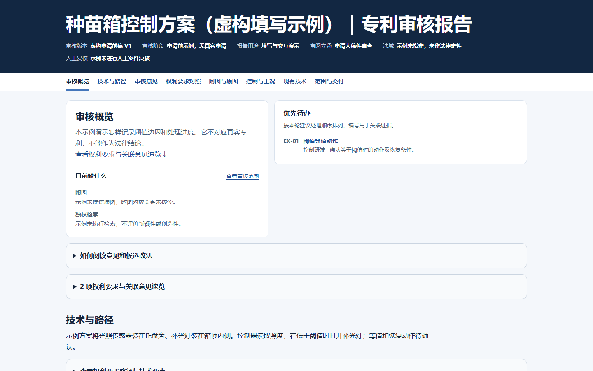

# Patent Review Kit

[简体中文](README.md) · [Changelog](CHANGELOG.md)

Review patent drafts, revised submissions, and published texts in one traceable report. Applicants can review drafting decisions. Product and R&D teams can map technical features and identify evidence gaps when reading a third-party patent.

## Account-free synthetic demo

**[Open the interactive report (Chinese)](https://krismiao97.github.io/patent-review-kit/)** · [Inspect the synthetic input](patent-draft-review/examples/template-input.json)

[](https://krismiao97.github.io/patent-review-kit/)

The fictional seedling chamber turns its lamp on below a light threshold. The draft leaves the behavior at the exact threshold unspecified. Open **EX-01** to follow the claim evidence, operating conditions, and proposed edit. Filter by the resolved status to see how the report tracks a completed issue.

The demo runs in your browser without a sign-in, API key, installation, or file upload. For offline use, download the repository and open [`docs/index.html`](docs/index.html). The demo uses fictional data and records no prior-art search.

## What the review delivers

| Use case | Output |
| --- | --- |
| Draft or revision review | Claim dependency paths, source excerpts, supporting evidence, reasons, and conditional edits. |
| Third-party patent review | Jurisdiction, document version, evidence limits, and open questions about product correspondence. |
| Drawings and operating conditions | Cross-references to claims and drawings, including threshold endpoints, state changes, and exceptions. |
| Independent claim searches | Separate novelty and inventive-step evidence, actual search scope, and gaps. |
| Report delivery | A filterable offline HTML report, plus optional annotated and clean Word copies when the source and review decisions are ready. |

## Get started

1. Copy [`patent-draft-review/`](patent-draft-review/) to your assistant’s skill directory. Keep the internal folder structure.
2. Provide the draft or publication, version, jurisdiction, procedural stage, and any drawings or prior-art material.
3. Ask the assistant to use `patent-draft-review`. For Word output, provide an editable DOCX and specify which changes you have accepted.

> Use patent-draft-review to review this pre-filing draft. Check claim dependencies, the specification, and drawings. Include source locations, supporting evidence, and conditions for proposed edits in an offline HTML report.

## Rebuild the demo locally

Run from the repository root with Python 3.10+. The HTML renderer uses the standard library.

```sh
python patent-draft-review/scripts/render_review.py patent-draft-review/examples/template-input.json --output demo-local.html
```

Word export requires `python-docx`. See [requirements.txt](requirements.txt), the [Word export guide](patent-draft-review/references/word-output.md), the [report design specification](patent-draft-review/DESIGN.md), and the [template schema](patent-draft-review/references/template-schema.md).

## WorkBuddy

Download the [WorkBuddy v0.4.0 ZIP](downloads/patent-draft-review-workbuddy-v0.4.0.zip). Import it through Skills → Add Skill → Upload Skill, then invoke `patent-draft-review` in a task. [WorkBuddy upload guide](https://www.workbuddy.cn/docs/workbuddy/From-Beginner-to-Expert-Guide/Function-Description/Skills-Market)
