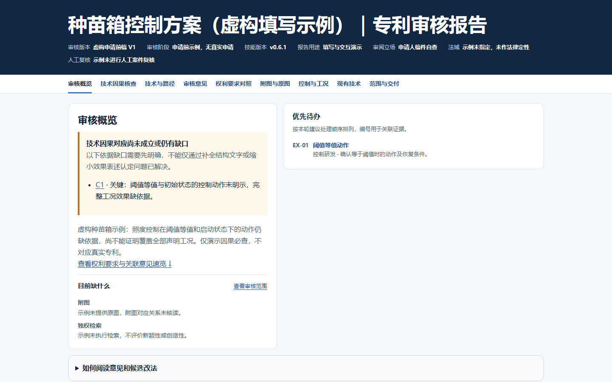

# Patent Review Kit

[简体中文](README.md) · [Changelog](CHANGELOG.md)

Review a patent draft before filing. Check the claims against the specification and drawings, then share actionable feedback with the drafter. Each issue includes source locations, evidence gaps, a proposed edit, and conditions for adopting it.

**[Read the 40 lx example in English](https://krismiao97.github.io/patent-review-kit/#example-en)** · **[Download the fictional draft and drawing (Chinese)](https://github.com/KrisMiao97/patent-review-kit/releases/download/v0.6.1/seedling-box-example.zip)** · **[Install the skill](#install-and-try)**

## Try the sample draft

The fictional draft describes a lamp that turns on below 40 lx and turns off above 40 lx. What happens at exactly 40 lx? Figure 1 shows the placement and connections of the components. Use the specification and engineering records to verify the controller's behavior at the threshold and during power-up.

1. Download and extract the archive. Give the assistant both `draft.md` and `figure-1.png`, keeping them together. You can also [read the draft on GitHub](patent-draft-review/examples/seedling-box/draft.md).
2. Send this prompt to an assistant with the skill installed.

   > Use patent-draft-review to review this pre-filing seedling-box draft. Check the claims, specification, and Figure 1. Cite the missing operating conditions, the exact source text, what engineering needs to confirm, and edits conditional on that confirmation. Limit the review to the provided materials and deliver an offline HTML report.

3. Compare your result with [EX-01 in the expected report](https://krismiao97.github.io/patent-review-kit/report.html#issue-EX-01). Check whether it identifies the equality case at exactly 40 lux and the default lamp state from power-up to the first valid reading, and distinguishes visible connections from unresolved control behavior.

[](https://krismiao97.github.io/patent-review-kit/report.html#issue-EX-01)

The [public trial page](https://krismiao97.github.io/patent-review-kit/) brings together the draft, installation, and interactive report. It requires no account or file upload. The materials are fictional and the sample review is limited to the supplied draft.

## Install and try

| Assistant | Installation |
| --- | --- |
| Codex | Run the command below in your project directory. The Skills CLI requires Node.js 22.20 or later. |
| WorkBuddy | [Open Patent Draft Review in WorkBuddy](https://www.workbuddy.cn/share/asset?shareCode=jtohFwwevZecQASf8oE3B6&sig=U4wRdfvbRACI8WNf). |
| Other Agent Skills hosts | Follow the host's instructions to import the full [`patent-draft-review/`](patent-draft-review/) directory. |

```sh
npx skills add https://github.com/KrisMiao97/patent-review-kit --skill patent-draft-review --agent codex --copy
```

The assistant environment needs Python 3.10+ to render the HTML report. For your own draft, provide the file, document version, jurisdiction, procedural stage, and available drawings or prior art. For annotated and clean Word copies, provide an editable DOCX and identify the accepted edits. [WorkBuddy import guide](https://www.workbuddy.cn/docs/workbuddy/From-Beginner-to-Expert-Guide/Function-Description/Skills-Market)

## What the skill delivers

| Use case | Output |
| --- | --- |
| Draft or revision review | Claim dependency paths, claim support in the specification, drawing references, and proposed edits. |
| Technical problem, solution, and effect | How the mechanism works, the conditions for its effects, and priority evidence gaps. |
| Claim amendment options | Conservative clarifications, balanced limitations, and narrower fallbacks with scope trade-offs. |
| Third-party patent review | Document version, jurisdiction, evidence coverage, and open questions about product correspondence. |
| Independent claim searches | Separate novelty and inventive-step search records, evidence, and coverage gaps. |
| Report delivery | Filterable offline HTML with evidence links and embedded drawings, and optional Word copies when source and decisions are ready. |

## Rebuild the sample report

Run from the repository root. The HTML renderer uses Python 3.10+ and its standard library.

```sh
python patent-draft-review/scripts/render_review.py patent-draft-review/examples/seedling-box/review.json --output demo-local.html
```

Current skill version is v0.6.1. See [requirements.txt](requirements.txt), the [Word export guide](patent-draft-review/references/word-output.md), and the [template schema](patent-draft-review/references/template-schema.md) for details.
