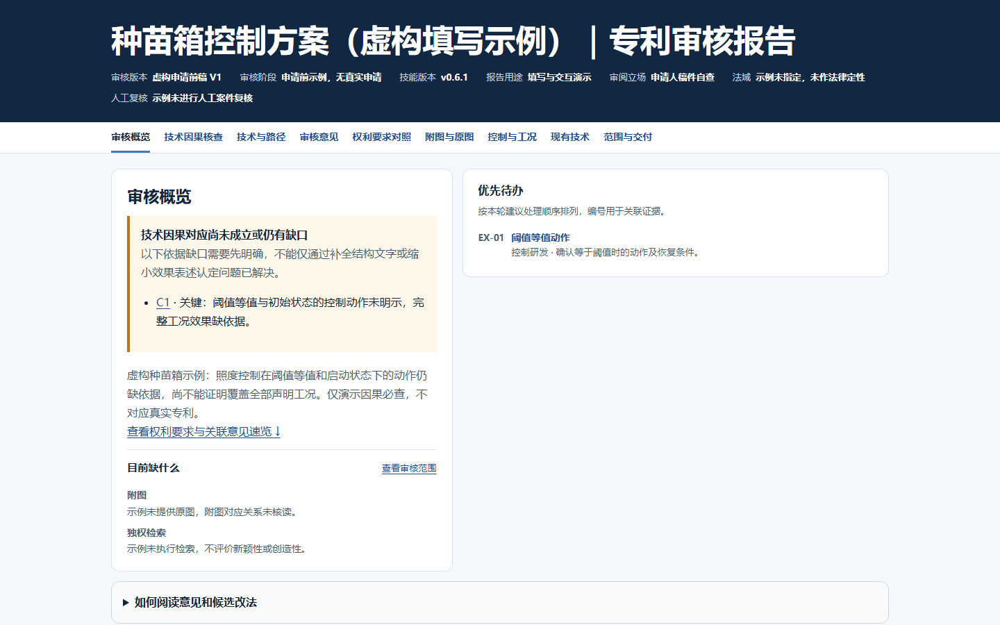

# 专利审稿工具包

[English](README.en.md) · [版本记录](CHANGELOG.md)

收到专利代理稿后，逐条核对权利要求、说明书和附图，生成一份可以反馈给代理师的审稿意见。每条意见标明原文位置、证据缺口、建议改法和采纳条件。

**[看交互报告](https://krismiao97.github.io/patent-review-kit/report.html#issue-EX-01)** · **[下载虚构样稿和附图](docs/seedling-box-example.zip)** · **[安装 Skill](#安装与试用)**

## 拿一份样稿试审

虚构种苗箱样稿规定照度低于 40 lx 时开灯，高于 40 lx 时关灯。照度正好等于 40 lx 时，灯会怎样动作？图 1 可以用来核对部件位置和连接。控制动作还要回到说明书和研发记录核实。

1. 下载并解压样稿。把 `draft.md` 和 `figure-1.png` 一起提供给助手，保留相对位置。也可以先[查看样稿正文](patent-draft-review/examples/seedling-box/draft.md)。
2. 在安装了 Skill 的助手里发送以下指令。

   > 请用 patent-draft-review 审核种苗箱申请前样稿。核对权利要求、说明书和图 1，指出控制条件缺失的工况，引用原文位置，给出需要研发确认的事项及相应改法。只做稿内核查，交付离线 HTML 报告。

3. 打开[预期报告中的 EX-01](https://krismiao97.github.io/patent-review-kit/report.html#issue-EX-01)，检查自己的报告是否找到了等值和首次上电两种工况，是否把图上可见的连接和需要确认的灯态分开记录。

[](https://krismiao97.github.io/patent-review-kit/report.html#issue-EX-01)

[公开试用页](https://krismiao97.github.io/patent-review-kit/)汇总样稿、安装方式和交互报告，无需账号或上传文件即可查看。试用材料为虚构示例，审稿范围限于所给稿件。

## 安装与试用

| 助手 | 安装方式 |
| --- | --- |
| Codex | 在要试用的项目目录运行下方命令。Skills CLI 需要 Node.js 22.20 或更新版本。 |
| WorkBuddy | 下载 [v0.6.1 导入包](downloads/patent-draft-review-workbuddy-v0.6.1.zip)，在「技能 → 添加技能 → 上传技能」中选择 ZIP。 |
| 其他支持 Agent Skills 的助手 | 按助手的安装说明导入完整的 [`patent-draft-review/`](patent-draft-review/) 目录。 |

```sh
npx skills add https://github.com/KrisMiao97/patent-review-kit --skill patent-draft-review --agent codex --copy
```

生成 HTML 报告需要助手环境可运行 Python 3.10+。审自己的稿件时，提供待审文件、稿件版本、法域和程序阶段。有附图或对比文献时一并提供。需要 Word 批注版和清洁版时，请提供可编辑的 DOCX，并明确采纳哪些修改。 [WorkBuddy 导入说明](https://www.workbuddy.cn/docs/workbuddy/From-Beginner-to-Expert-Guide/Function-Description/Skills-Market)

## 审稿能交付什么

| 场景 | 交付 |
| --- | --- |
| 申请前审稿、复核返稿 | 沿权项引用路径核对限定。逐条记录权利要求原文、说明书支持、附图对应和修改建议。 |
| 技术问题、方案与效果 | 核对方案如何起作用、效果在哪些条件下成立。把关键缺口放在报告首页。 |
| 权项改法 | 给出保守澄清、平衡限定和收窄后备的选择。写清适用条件、保护范围取舍和实施例组合依据。 |
| 使用方审阅第三方专利 | 标明法域、文本版本和证据范围，结合产品技术事实定位待核问题。 |
| 独立项检索 | 分别记录新颖性与创造性核查的实际检索范围、证据及缺口。 |
| 报告交付 | 可筛选的离线 HTML，含证据跳转和内嵌原图。满足条件时可另出 Word 批注版与清洁版。 |

## 从记录生成示例报告

从仓库根目录运行。HTML 生成器只需要 Python 3.10+ 和标准库。

```sh
python patent-draft-review/scripts/render_review.py patent-draft-review/examples/seedling-box/review.json --output demo-local.html
```

当前 Skill 版本为 v0.6.1。Word 依赖见 [requirements.txt](requirements.txt)。具体交付条件见[输出说明](patent-draft-review/references/word-output.md)，报告字段见[模板数据说明](patent-draft-review/references/template-schema.md)。
