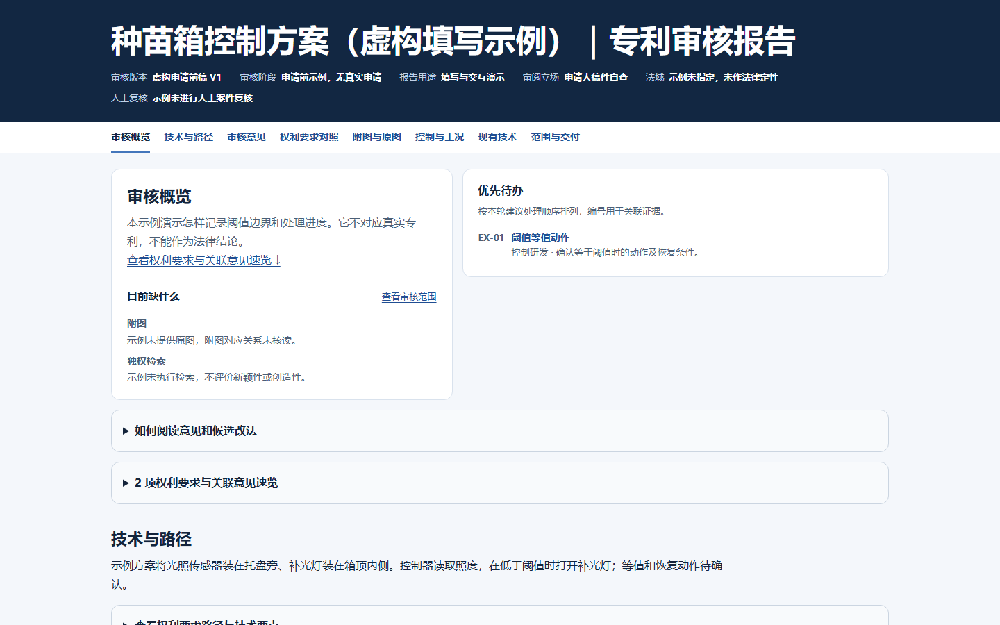

# 专利审稿工具包

[English](README.en.md) · [版本记录](CHANGELOG.md)

用一份可追溯的审核报告复核专利稿件、返稿和公开文本。适合申请人检查代理稿，也适合产品或研发团队从使用方立场梳理第三方专利的技术对应和证据缺口。

## 无需账号的合成演示

**[打开交互式审核报告](https://krismiao97.github.io/patent-review-kit/)** · [查看合成输入数据](patent-draft-review/examples/template-input.json)

[](https://krismiao97.github.io/patent-review-kit/)

演示以虚构的种苗箱为例。照度低于阈值时开灯，恰好等于阈值时该怎样动作仍待确认。点击 **EX-01**，查看权项原文、工况依据和建议改法。再用「处理进度」筛选「已解决」，复核另一条意见怎样记录处理结果。

在浏览器打开即可交互，访客无需登录、API 密钥、安装或上传文件。需要离线浏览时，可下载仓库并打开 [`docs/index.html`](docs/index.html)。演示使用虚构数据，未执行实际检索。

## 审稿能交付什么

| 场景 | 交付 |
| --- | --- |
| 申请前或返稿审查 | 按权项引用路径核对限定，逐条记录原文、证据、理由、改法与适用条件。 |
| 使用方审阅公开文本 | 标明法域、文本版本和证据范围，结合产品技术事实定位待核问题。 |
| 工况与图文复核 | 核对阈值端点、动作和故障工况，关联权项、图号和原图。 |
| 独立项检索 | 分开记录新颖性和创造性证据、实际检索范围及缺口。 |
| 审稿交付 | 提供可筛选的离线 HTML。满足条件时，另出正文一致的 Word 批注版和清洁版。 |

## 开始使用

1. 将 [`patent-draft-review/`](patent-draft-review/) 放入支持 `SKILL.md` 的助手技能目录，保留其内部结构。
2. 提供待审文件、稿件版本、法域和程序阶段，以及已有附图或对比文献。
3. 在对话中指定使用 `patent-draft-review`。需要 Word 时提供可编辑的 DOCX，并明确已采纳的修改。

> 请用 patent-draft-review 审核这份申请前代理稿。逐条核对权利要求引用、说明书和附图，列出原文位置、证据、修改建议及采纳条件，交付离线 HTML 审核报告。

## 本地复现演示

从仓库根目录运行，使用 Python 3.10+。HTML 生成器只使用标准库。

```sh
python patent-draft-review/scripts/render_review.py patent-draft-review/examples/template-input.json --output demo-local.html
```

Word 导出依赖 `python-docx`，安装方式见 [requirements.txt](requirements.txt)。导出条件和步骤见 [Word 双版本](patent-draft-review/references/word-output.md)，报告版式和字段见 [设计规范](patent-draft-review/DESIGN.md)及[模板数据说明](patent-draft-review/references/template-schema.md)。

## WorkBuddy

下载 [WorkBuddy v0.4.0 ZIP](downloads/patent-draft-review-workbuddy-v0.4.0.zip)。在 WorkBuddy「技能 → 添加技能 → 上传技能」中选择 ZIP，导入后可在对话中指定 `patent-draft-review`。 [WorkBuddy 官方导入说明](https://www.workbuddy.cn/docs/workbuddy/From-Beginner-to-Expert-Guide/Function-Description/Skills-Market#%E4%B8%8A%E4%BC%A0%E6%8A%80%E8%83%BD)
