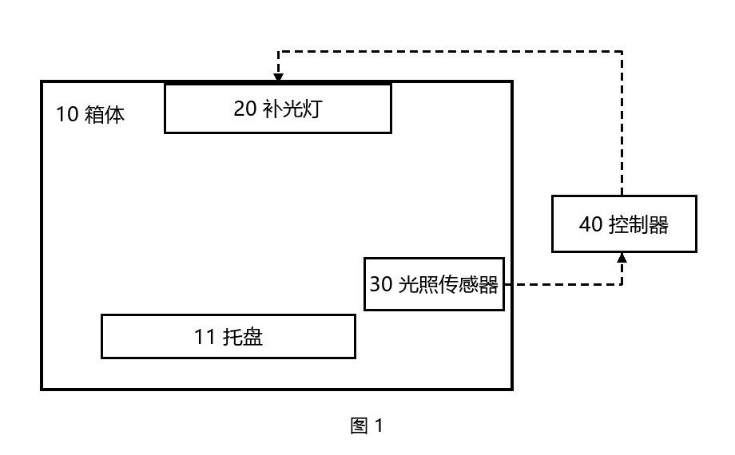

# 种苗箱的补光控制装置

虚构申请前样稿 V1。审阅立场为申请人，按中国发明专利申请前稿组织。样稿供练习使用。

## 技术交底摘要

[D01] 种苗箱内的托盘放置幼苗。在环境光照不足时，补光灯从托盘上方提供照明。研发提供了部件布置、信号连接和两个照度判断条件。

## 权利要求书

1. 一种种苗箱的补光控制装置，包括箱体、设置于所述箱体内的托盘、补光灯、光照传感器和控制器。控制器根据光照传感器输出控制补光灯。
2. 根据权利要求 1 所述的补光控制装置，其中所述补光灯设置在所述箱体的顶壁内侧，所述光照传感器设置在所述托盘旁。

## 说明书

[0017] 如图 1 所示，托盘 11 设置于箱体 10 内。补光灯 20 设置在箱体 10 的顶壁内侧，光照传感器 30 装在托盘旁。光照传感器 30 的输出接至控制器 40 的输入，控制器 40 的输出接至补光灯 20。

[0018] 控制器 40 读取光照传感器 30 输出的照度值。照度低于 40 lx 时开启补光灯。照度高于 40 lx 时关闭补光灯。

[0019] 补光灯开启时从托盘上方向下照明。

## 附图

图 1 为补光控制装置的部件布置和信号连接示意图。虚线箭头表示信号方向。

